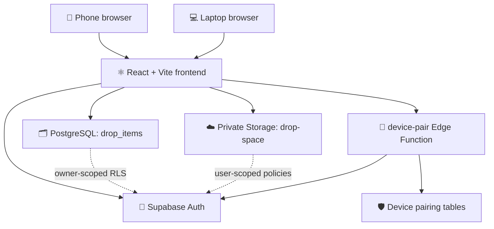

<div align="center">

# ☁️ DropSpace

### Your things. Anywhere you are.

**A private digital pocket for files, notes, and links — accessible across your devices.**

[](https://shareprivate.netlify.app/)
[](https://react.dev/)
[](https://supabase.com/)
[](https://netlify.com/)

[](https://github.com/Raghavuchiha/drop-space/commits/main)
[](https://github.com/Raghavuchiha/drop-space/issues)
[](https://github.com/Raghavuchiha/drop-space/stargazers)

**[🚀 Try Live App](https://shareprivate.netlify.app/)** · **[⚡ Quick Start](#-quick-start)** · **[🔐 Device Pairing](#-link-another-device)** · **[🏗️ Architecture](#️-architecture)**

</div>

---

## 📌 About DropSpace

Ever sent yourself a file on a messaging app just to open it on your laptop?

**DropSpace makes that workflow simpler.** Upload a file, jot down a note, or save a URL in a personal cloud workspace; pick it up from another browser or device when you need it. Your content is associated with your authenticated account rather than a particular device.

> [!NOTE]
> DropSpace is a **personal storage MVP**, not an anonymous public file-sharing service, a full backup platform, or an end-to-end encrypted vault.

## ✨ Features

| Feature | What it does |
|:--|:--|
| 📁 **File storage** | Upload one or multiple files via drag-and-drop or file picker; preview, download and delete |
| 📝 **Quick notes** | Save small snippets, ideas and reminders across devices |
| 🔗 **Saved links** | Keep website URLs alongside your files and notes |
| 🔎 **Organized library** | Search, filter by item type, sort, star and switch between grid/list layouts |
| 🔒 **Private workspace** | Supabase authentication, private Storage bucket and owner-scoped RLS policies |
| 💻 **Responsive UI** | Desktop and mobile layouts with a consistent workspace |
| 🔑 **Link another device** | Temporary pairing code, approval from an existing device and a separate new login session |
| 🚪 **Device-local logout** | Signing out on one browser is designed to preserve other device sessions |

### 🖥️ Preview

The current interface includes a personal workspace dashboard, upload drop zone, file/notes/link collection and a **Link device** action.

**[Open the live DropSpace experience →](https://shareprivate.netlify.app/)**

> Screenshots and demo GIFs can be added here after capturing them from a real signed-in workspace. No placeholder screenshots are included.

---

## 🔑 Link another device

You can use a second device without re-entering account credentials:

1. On **Device A**, sign in normally and select **Link device**.
2. Copy the temporary **10-character pairing code**.
3. On **Device B**, select **Sign in with a device code** and enter the code.
4. **Approve** the new-device request on Device A.
5. Device B completes authentication using its own Supabase session.

**Pairing safeguards:** Codes expire after **2 minutes**, can be claimed only once, and require confirmation from a previously authenticated device. Pairing uses an Edge Function and a fresh one-time Supabase Auth handoff, not a copy of Device A's refresh token.

> [!IMPORTANT]
> Only approve pairing requests you initiated. The code alone must not grant access. Device management/revocation UI is not yet part of this MVP. See [device-pairing technical notes](docs/device-pairing.md).

## 🛠️ Tech stack

| Layer | Technology |
|:--|:--|
| Frontend | React 19, Vite 6, CSS, Lucide React |
| Identity | Supabase Auth (email/password in this repository) |
| Database | Supabase PostgreSQL |
| File storage | Supabase Storage (private bucket) |
| Authorization | PostgreSQL Row Level Security + Storage policies |
| Device pairing API | Supabase Edge Functions (Deno / TypeScript) |
| Deployment | Netlify (frontend) + Supabase (backend) |

> Google OAuth is **not** implemented in the checked-in frontend at present; the authentication form in this repository uses email/password. Google can be configured separately as an auth provider.

## 🏗️ Architecture



<details>
<summary><strong>📂 Repository structure</strong></summary>

```text
drop-space/
├── src/
│   ├── App.jsx                  # Auth, workspace, item management
│   ├── DevicePairing.jsx        # Code entry and approval screens
│   ├── supabase.js              # Supabase client + auth utilities
│   ├── styles.css               # Responsive app styles
│   └── main.jsx
├── supabase/
│   ├── setup.sql                # Private files and library schema/policies
│   ├── device_pairing.sql       # Pairing data schema
│   └── functions/
│       └── device-pair/
│           └── index.ts        # Pairing request/approval API
├── docs/
│   └── device-pairing.md        # Pairing setup + security notes
├── index.html
├── package.json
├── package-lock.json
└── vite.config.js
```

</details>

---

## ⚡ Quick start

### Prerequisites

- **Node.js 22+** and npm
- A **Supabase project**
- Internet access for cloud-backed features

### 1. Clone and install

```bash
git clone https://github.com/Raghavuchiha/drop-space.git
cd drop-space
npm ci
```

### 2. Configure Supabase

Create a project at [Supabase](https://supabase.com/dashboard), then run these SQL files in the project's **SQL Editor**:

1. `supabase/setup.sql` — private item table and Storage bucket policies.
2. `supabase/device_pairing.sql` — restricted device pairing tables.

Under **Authentication → Providers**, enable Email authentication (for the current login UI).

Create a `.env` file in the project root:

```dotenv
VITE_SUPABASE_URL=https://YOUR_PROJECT_REF.supabase.co
VITE_SUPABASE_PUBLISHABLE_KEY=sb_publishable_YOUR_PUBLIC_KEY
```

> [!CAUTION]
> Use a **publishable** key in the frontend. Never place a Supabase `service_role` key, secret key, or database password in `VITE_*` variables or commit them to Git.

### 3. Run locally

```bash
npm run dev
```

Visit **http://localhost:5173**.

### 4. Enable device pairing (optional)

Deploy `supabase/functions/device-pair/index.ts` as a Supabase Edge Function named **`device-pair`**. It requires server-side Supabase environment credentials, including `SUPABASE_SERVICE_ROLE_KEY`; never expose these to the browser.

The function has its **own action-specific authentication checks**, and its deployed configuration uses `verify_jwt = false` so an unauthenticated device can submit a pairing claim. Privileged actions still verify the account JWT in the function itself.

Read [docs/device-pairing.md](docs/device-pairing.md) for the full flow, deployment notes and limitations. Ensure production origins in `index.ts` match your deployed domain.

### 5. Build

```bash
npm run build
npm run preview
```

---

## ☁️ Deploy

<details>
<summary><strong>Deploy frontend to Netlify</strong></summary>

1. Connect the GitHub repository to Netlify.
2. Set **Build command** to `npm run build` and **Publish directory** to `dist`.
3. Add `VITE_SUPABASE_URL` and `VITE_SUPABASE_PUBLISHABLE_KEY` to site environment variables.
4. In Supabase Auth URL configuration, set the correct Site URL and permitted redirects for your deployment.
5. Redeploy, then test signup/login, uploads, and device pairing on actual devices.

Live instance: **https://shareprivate.netlify.app/**

</details>

## 🔐 Security & limitations

- Each `drop_items` row belongs to a single user and is protected by **RLS**.
- Files are stored in a **non-public** `drop-space` bucket under user-prefixed paths.
- File previews use time-limited **signed URLs** (currently 60 seconds).
- The UI enforces **50 MB per file**; project-level quotas may impose additional limits.
- Device pairing uses stored **code hashes**, expiry checks, separate claim verification and owner approval.
- Ordinary logout uses **local scope**, preserving other active devices where the auth provider allows.
- Pairing and login flows have **not been presented as independently security-audited**.
- This MVP does not provide malware scanning, full account device inventory, automatic backups, or end-to-end encryption.

## 🧰 Troubleshooting

<details>
<summary><strong>Common setup and authentication issues</strong></summary>

| Symptom | Check |
|:--|:--|
| Setup screen appears | Confirm both `VITE_*` variables are populated and restart Vite |
| `drop_items` relation missing | Run `supabase/setup.sql` against the correct project |
| Upload RLS error | Verify `drop-space` bucket and user-owned object path policies |
| Device pairing function error | Confirm SQL migration, deployed `device-pair` function, allowed origin and server-side environment variables |
| Pairing code rejected | Generate a fresh code before the 2-minute expiry and approve on Device A |
| `session_not_found` or authentication failed | Sign in again; old sessions may have been revoked by prior global logout |
| Other device has an empty library | Check it is signed in to **the same user account** and Supabase project |

</details>

## 🗺️ Roadmap

- [ ] Manage linked devices and revoke individual sessions from the UI
- [ ] Upload progress and resumable transfers
- [ ] Folder organization and tags
- [ ] Password reset and optional social OAuth
- [ ] Link previews and clipboard-to-note shortcuts
- [ ] PWA install support and improved offline experience
- [ ] Improved rate limiting, audits and monitoring

## 🤝 Contributing

Suggestions and bug reports are welcome via [GitHub Issues](https://github.com/Raghavuchiha/drop-space/issues). For code changes, open a pull request with a concise description and steps to reproduce or test the change.

---

<div align="center">

**Made for the little things that matter.**

Built by [@Raghavuchiha](https://github.com/Raghavuchiha) · [Live app](https://shareprivate.netlify.app/) · [Issues](https://github.com/Raghavuchiha/drop-space/issues)

</div>
